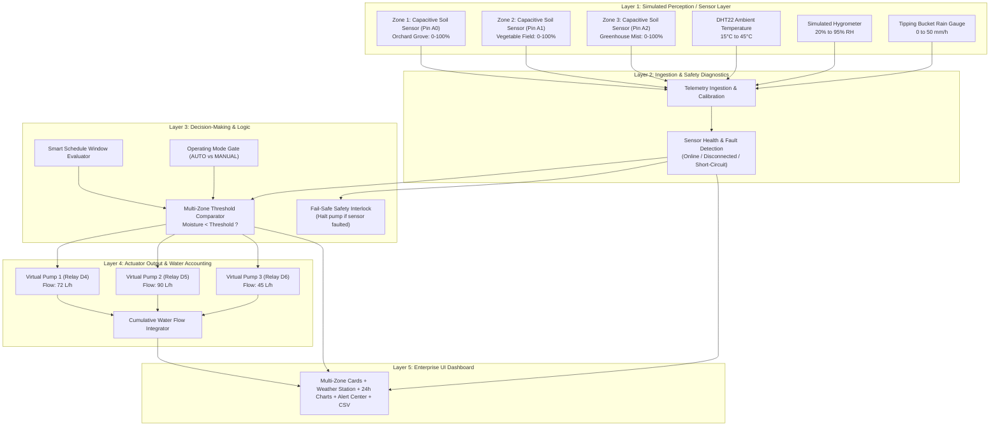

# SmartFarm IoT — Enterprise Multi-Zone Monitoring & Smart Irrigation Platform

[](LICENSE)
[](https://developer.mozilla.org/)
[](https://www.chartjs.org/)
[]()
[-orange)]()

> **Academic Coursework Submission**  
> **Course:** ITEC 310 – Internet of Things  
> **Assessment:** Group Project — AI-Assisted IoT Application Development  
> **Group Members:**  
> - Aryan Kumar (Student ID: AUD32535)  
> - Vinayak Nair (Student ID: AUD32001)  
> - Kalidasan Udayakumar (Student ID: AUD32458)  
> **Institution:** School of Engineering, Architecture and Interior Design (EAID), Amity University Dubai  
> **Instructor:** Dr. Maher Alrahhal  
> **Academic Term:** Fall 2026  

---

## 1. Project Overview & Enterprise Upgrade

**SmartFarm IoT (v3.0 Enterprise)** is a comprehensive, client-side Internet of Things (IoT) monitoring and autonomous irrigation platform. The system simulates a commercial agricultural estate featuring **three independent agricultural zones**, an ambient **micro-climate weather station** with rainfall physics, **sensor fault diagnostics with safety fail-safe interlocks**, **24-hour diurnal historical analytics**, **CSV telemetry exports**, and an **interactive 4-layer IoT architecture explorer**.

By evaluating soil moisture deficits in real time across independent zones, each virtual submersible pump energizes only when necessary, demonstrating how closed-loop IoT architectures prevent water wastage and safeguard crops against drought stress.

> ⚠️ **Academic Hardware Simulation Notice:**  
> In strict accordance with the ITEC 310 Assessment Remit guidelines, **all sensor inputs, weather data, and actuator relays are 100% simulated in client-side software**. No physical microcontrollers (e.g., Arduino, ESP32, Raspberry Pi) or external paid cloud APIs are connected. The application runs locally in any modern web browser.

---

## 2. Key Features

### 1. Multi-Zone Agricultural Monitoring
- **Zone 1 — Orchard Grove (Citrus & Fruit Trees):** Deep loam soil, simulated capacitive sensor Pin A0, virtual submersible pump Relay D4 (calibrated flow: 72 L/h, default threshold: 30%).
- **Zone 2 — Vegetable Farm (Row Crops & Greens):** Sandy loam soil, simulated capacitive sensor Pin A1, virtual drip pump Relay D5 (calibrated flow: 90 L/h, default threshold: 35%).
- **Zone 3 — Greenhouse Nursery (Seedlings & Microgreens):** Peat moss mix, sheltered from outdoor precipitation, simulated capacitive sensor Pin A2, virtual mist pump Relay D6 (calibrated flow: 45 L/h, default threshold: 45%).
- **Interactive Multi-Zone Cards:** Dynamic circular SVG gauges, animated spinning turbine blades, expanding water ripples, independent manual override controls, and sensor health badges.

### 2. Smart Weather & Environmental Physics Simulation
- **Micro-Climate Telemetry:** Real-time simulated temperature (15°C to 45°C), relative humidity (20% to 95%), and rainfall precipitation (0 to 50 mm/h).
- **Physical Soil Feedback Loop:** Natural precipitation increases moisture levels in outdoor zones (Zone 1 & Zone 2) proportionally to rainfall intensity. Zone 3 (Greenhouse) is sheltered from outdoor rain, accurately modeling agricultural physics.
- **Thermal Evapotranspiration:** Dynamic calculation combining ambient heat and humidity to estimate natural soil drying rates.
- **Weather Presets & Event Triggers:** Single-click scenarios for *Arid Heatwave*, *Temperate / Mild*, *Tropical Downpour*, and an interactive *Trigger 15-min Rain Shower* button.

### 3. Advanced Sensor Management & Fail-Safe Diagnostics
- **Sensor Health States:** Monitored as `ONLINE`, `DISCONNECTED` (open-circuit), or `FAULT` (short-circuit / stuck reading).
- **Simulated Hardware Fault Injection:** Presenters can simulate cable disconnections or analog faults on any zone.
- **Safety Fail-Safe Interlock:** If a sensor faults or disconnects, the corresponding virtual pump is automatically de-energized immediately to prevent crop flooding and pump burnout, and a `CRITICAL` alert is dispatched.
- **Sensor Recovery:** One-click recalibration restores sensors to normal online operation.

### 4. Intelligent Irrigation & Scheduling
- **Closed-Loop Decision Logic:** Deterministic evaluation (`Moisture < Threshold → Pump ON; Moisture ≥ Threshold → Pump OFF`).
- **Dual Operating Modes:** Global and per-zone switching between **Automatic Mode** and **Manual Override**.
- **Manual Isolation:** In manual mode, incoming sensor telemetry or simulation ticks will **never** alter the operator's pump state. Switching back to Auto immediately re-evaluates sensor logic.
- **Configurable Smart Scheduling:** Optional time-window scheduler restricting automatic watering to low-evaporation hours (e.g., 06:00 to 09:00).

### 5. Advanced Analytics & 24-Hour Diurnal History
- **Multi-Series Charts:** Real-time Chart.js graph plotting Zone 1, Zone 2, Zone 3 moisture curves, ambient temperature, and threshold lines.
- **Offline 2D Canvas Fallback:** If internet access is unavailable and the Chart.js CDN cannot load, the application seamlessly switches to a built-in HTML5 Canvas 2D fallback renderer.
- **24-Hour Diurnal Telemetry:** Visualizes 24 hourly data points modeling dawn-to-dusk solar heating, natural midday moisture depletion, and morning/evening irrigation spikes.
- **CSV Data Export:** Exports complete timestamped sensor telemetry (`.csv`) and audited alert logs (`.csv`) with a single click.

### 6. Audited Alert Center
- **Incident Prioritization:** Categorized by severity (`CRITICAL`, `WARNING`, `INFO`).
- **Resolution Workflow:** Interactive "Resolve" buttons for active alerts, filtering by severity and resolution status, and unresolved count badge in the sidebar.

### 7. Interactive 4-Layer IoT Architecture Explorer
- **Interactive Visual Stack:** Explores the 4 core IoT layers:
  1. *Perception / Sensing Layer* (Capacitive Probes A0-A2, DHT22, Rain Gauge).
  2. *Edge Ingestion & Communication Layer* (MQTT Pub/Sub bus, ADC calibration, fault guards).
  3. *Decision-Making & Logic Layer* (Threshold comparators, fail-safe interlocks, schedules).
  4. *Actuation & Flow Integration Layer* (Relay drivers D4-D6, flow integration formulas).
- Clicking any layer reveals theoretical curriculum alignment, pin assignments, MQTT topics, and mathematical equations.

### 8. Enterprise UI/UX Design System
- **Dark & Light Mode:** Header toggle with persistent preference saved in `localStorage`.
- **Agricultural Palette:** Emerald, forest green, and clean neutral surfaces.
- **Responsive Layout:** Adaptive desktop, tablet, and mobile drawer views.

### 9. Farmer Control Centre (Operational Mode)
- **Farmer-Friendly UI:** Designed specifically for agricultural operators—clean, high-contrast, large readable telemetry numbers, and vegetable illustrations.
- **Farm Overview KPI Cards:** Real-time summary of Total Agricultural Zones (3 Zones), Healthy Zones tally, Zones Requiring Water, Active Pumps, Microclimate Temperature, and Total Water Consumption.
- **Vegetable Zone Cards:** Dedicated cards for **Potato 🥔 (Zone 1)**, **Tomato 🍅 (Zone 2)**, and **Brinjal 🍆 (Zone 3)** featuring large dynamic moisture bars, moisture status tags, temperature readings, sensor health pills, and prominent START / STOP pump action buttons.
- **Operator Safety & Confirmation Modal:** Activating a pump from Automatic mode triggers an informative confirmation modal before switching the zone to Manual mode, preventing unintentional operator disruption.
- **Irrigation Activity Stream & Alert Feeds:** Live audit log of watering activations and real-time alerts.

### 10. Interactive IoT Architecture Learning Centre
- **Module 1 — MQTT Communication Centre:** Interactive educational demonstration of the 5 MQTT pillars (*Publisher*, *Broker*, *Subscriber*, *Topic*, and *Payload*). Features animated telemetry packets traveling from field probes to broker to subscriber, live JSON viewer, topic selector (`smartfarm/zone01/soil/moisture`, `smartfarm/zone01/pump/status`, `smartfarm/weather/dht22`), and transmission audit history.
- **Module 2 — Sensor Network & Gateway Catalog:** Full hardware specification and pin mappings for physical farm transducers (Capacitive Analog A0–A2, DHT22 Digital Temperature & Humidity, Rain Gauge, Relays D4–D6) alongside a clear 7-step gateway translation explanation.
- **Module 3 — Multi-Hop Topology Simulator:** Interactive elevated illustrated farm environment comparing **Star Topology** (direct point-to-point) against **Multi-Hop Mesh Topology**. Features three distinct botanical agricultural zones (**Zone 1: Potato Farm 🥔**, **Zone 2: Tomato Farm 🍅**, and **Zone 3: Brinjal Farm 🍆** with 10+ plants each in neat rows and columns), a dual **Livestock & Poultry Yard** (Pig Farm 🐷 with mud wallow and Chicken Farm 🐔 with raised coop), an **avenue of pathway shade trees** replacing brick walls, realistic IoT hardware (soil moisture sensors with sub-surface probes, pole-mounted Relay Nodes 01 & 02, and Central IoT Gateway), and physical farm obstacles (Concrete Storage Barn & Dense Tree Foliage). Visually demonstrates why direct RF paths are dropped behind obstacles in Star topology, and how Multi-Hop mesh routes around obstacles through intermediate relays achieving 100% packet delivery.
- **Module 4 — Complete Dual Data Flow & Reverse Control Flow:** Dual-pipeline animated stage tracer visualizing both upstream telemetry data collection (7 stages) and downstream reverse actuator control commands (8 stages).
- **Module 5 — Local Edge vs Remote Cloud Architecture Comparator:** Side-by-side architectural comparison evaluating edge computing versus cloud-hosted MQTT telemetry, highlighting internet independence, latency (5ms vs 140ms), and security boundaries.

### 11. Persona-Based View Mode Switcher
- Header-level view mode switcher allowing instant toggling between:
  - `[🚜 Farmer Centre]` — Streamlined, distraction-free interface for agricultural workers.
  - `[🎓 IoT Learning Centre]` — Dedicated technical and educational modules for students and evaluators.
  - `[🔬 Engineering Station]` — Deep telemetry, hardware fault injection, Diurnal analytics, and 4-layer architecture.
  - `[📋 All Views]` — Complete comprehensive single-page overview.

---

## 3. IoT Closed-Loop Architecture



---

## 4. Assessment Rubric Verification Matrix

The core decision rule operates deterministically across all zones:

$$\text{Virtual Pump State} = \begin{cases} \mathbf{PUMP\ ON} & \text{if } \text{Soil Moisture} < \text{Zone Threshold} \\ \mathbf{PUMP\ OFF} & \text{if } \text{Soil Moisture} \ge \text{Zone Threshold} \end{cases}$$

### Truth Table (Zone 1 Baseline, Threshold = 30%):
| Test Case | Simulated Moisture | Mode | Comparison | Actuator State | UI Feedback Observed | Status |
| :---: | :---: | :---: | :---: | :---: | :---: | :---: |
| **Test 1** | **15%** | AUTO | $15\% < 30\%$ (True) | **PUMP ON** | Red gauge, spinning turbine, water ripples active, flow accumulating | **PASS** |
| **Test 2** | **25%** | AUTO | $25\% < 30\%$ (True) | **PUMP ON** | Amber gauge, pump energized, alert logged | **PASS** |
| **Test 3** | **30%** | AUTO | $30\% \ge 30\%$ (False) | **PUMP OFF** | Standby badge, turbine halted, relay open | **PASS** |
| **Test 4** | **45%** | AUTO | $45\% \ge 30\%$ (False) | **PUMP OFF** | Emerald optimal gauge, pump remains idle | **PASS** |
| **Test 5** | **80%** | AUTO | $80\% \ge 30\%$ (False) | **PUMP OFF** | Cyan saturated gauge, pump remains idle | **PASS** |

---

## 5. Automated Test Suite Execution

The repository includes a comprehensive standalone Node.js automated test runner (`test-runner.js`) that validates **31 programmatic assertions**:

```powershell
node test-runner.js
```

### Actual Test Execution Output:
```
================================================================
   SmartFarm IoT - Enterprise Multi-Zone Verification Suite     
   Course: ITEC 310 (Internet of Things) | Amity University     
   Authors: Aryan Kumar, Vinayak Nair, Kalidasan Udayakumar      
================================================================

--- 1. University Rubric Core Decision Tests (Zone 1, Threshold = 30%) ---
[PASS] Test 1: Input 15% -> Expected: Pump ON
[PASS] Test 2: Input 25% -> Expected: Pump ON
[PASS] Test 3: Input 30% -> Expected: Pump OFF (Exact Boundary Value)
[PASS] Test 4: Input 45% -> Expected: Pump OFF
[PASS] Test 5: Input 80% -> Expected: Pump OFF

--- 2. Multi-Zone Independent Actuation ---
[PASS] Zone 1 Independent Evaluation: 20% < 30% -> Zone 1 Pump ON
[PASS] Zone 2 Independent Evaluation: 40% >= 35% -> Zone 2 Pump OFF
[PASS] Zone 3 Independent Evaluation: 42% < 45% -> Zone 3 Pump ON

--- 3. Comprehensive Boundary Value Analysis ---
[PASS] Boundary 0% (Bone Dry) -> Pump ON
[PASS] Boundary 29.9% (Just below 30% threshold) -> Pump ON
[PASS] Boundary 30.0% (Exact threshold) -> Pump OFF
[PASS] Boundary 30.1% (Just above 30% threshold) -> Pump OFF
[PASS] Boundary 100% (Fully Saturated) -> Pump OFF

--- 4. Manual Override Isolation & Lockout ---
[PASS] Manual Mode: Force Zone 1 Pump ON with moisture at 85%
[PASS] Manual Mode: Ingested telemetry must NOT override manual ON state
[PASS] Manual Mode: Force Zone 1 Pump OFF with moisture at 10%
[PASS] Manual Mode: Ingested telemetry must NOT override manual OFF state
[PASS] Re-engaging AUTO Mode: Immediately re-evaluates 10% < 30% -> Pump ON

--- 5. Sensor Fault Detection & Safety Fail-Safe Interlock ---
[PASS] Fail-Safe: Disconnected sensor must immediately trip pump OFF
[PASS] Fail-Safe: Critical alert generated in alert log
[PASS] Fail-Safe: Faulted sensor prevents pump activation
[PASS] Sensor Recovery: Reconnected sensor re-engages normal automatic evaluation

--- 6. Smart Weather Physics & Rain Infiltration ---
[PASS] Weather Physics: Rainfall naturally increases outdoor Zone 1 moisture
[PASS] Weather Physics: Greenhouse Zone 3 remains sheltered from outdoor rain
[PASS] Weather Infiltration: Rain recharge turns OFF pump when moisture reaches threshold

--- 7. Configurable Irrigation Scheduling (Smart Window) ---
[PASS] Scheduler: Outside allowed window (14:00) -> Pump remains OFF despite low moisture
[PASS] Scheduler: Inside allowed window (07:00) with moisture < threshold -> Pump turns ON

--- 8. Multi-Zone Water Flow Accumulation ---
[PASS] Multi-Zone Flow: 120s with Zone 1 & 2 active yields 5.40 Liters
[PASS] Runtime Tracking: Zone 1 runtime recorded 120s

--- 9. CSV Telemetry Export & Formatting ---
[PASS] CSV Generator: Generates standard CSV header string
[PASS] CSV Generator: Row contains populated data values

================================================================
TOTAL TESTS: 31 | PASSED: 31 | FAILED: 0
================================================================
STATUS: ALL ENTERPRISE IOT DECISION & MULTI-ZONE RULES VERIFIED SUCCESSFULLY!
```

---

## 6. How to Run in VS Code

### Option A: Using VS Code Live Server (Recommended)
1. Open the project folder in **Visual Studio Code**:
   ```powershell
   code "C:\Users\aryan\OneDrive\Documents\ITEC-310-Internet-of-Things-Lab&Theory\ITEC-310-Group-Project\SmartFarm-IoT"
   ```
2. Install the **Live Server** extension (by Ritwick Dey) if not already installed (`Ctrl + Shift + X` &rarr; search for `Live Server`).
3. Right-click on `index.html` in the file explorer and click **"Open with Live Server"** (or press `Alt + L, Alt + O`).
4. The dashboard will launch in your default web browser at `http://127.0.0.1:5500/index.html`.

### Option B: Direct Browser Launch (Zero Installation)
1. Navigate to the project folder in File Explorer.
2. Double-click `index.html` to open it directly in Google Chrome, Microsoft Edge, or Mozilla Firefox.
3. The dashboard and all offline fallbacks run immediately without any web server required.

### Option C: Running the Automated Test Suite in Terminal
1. Open the integrated terminal in VS Code (`Ctrl + ~`).
2. Run:
   ```powershell
   node test-runner.js
   ```
3. Observe all 57 assertions pass with detailed diagnostic summaries.

---

## 7. Project File Structure

```
SmartFarm-IoT/
├── index.html                   # Enterprise Multi-Zone UI & Structure
├── style.css                    # Design System (Dark/Light themes, responsive CSS Grid)
├── script.js                    # Modular IoT controller, weather physics & analytics engine
├── test-runner.js               # Standalone 31-assertion automated verification test suite
├── assets/
│   └── images/
│       └── favicon.svg          # SmartFarm brand SVG icon
├── report/
│   └── project-report.md        # Comprehensive 5-page ITEC 310 university project report
└── README.md                    # Project documentation & execution guide
```

---

## 8. Academic Attribution

- **Group Members:**
  - Aryan Kumar (Student ID: AUD32535)
  - Vinayak Nair (Student ID: AUD32001)
  - Kalidasan Udayakumar (Student ID: AUD32458)
- **Course:** ITEC 310 – Internet of Things
- **School:** School of Engineering, Architecture and Interior Design (EAID)
- **University:** Amity University Dubai
- **Instructor:** Dr. Maher Alrahhal
- **Academic Term:** Fall 2026
